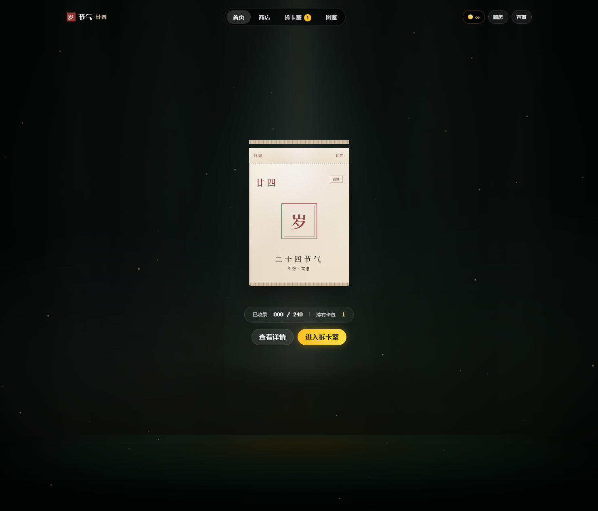
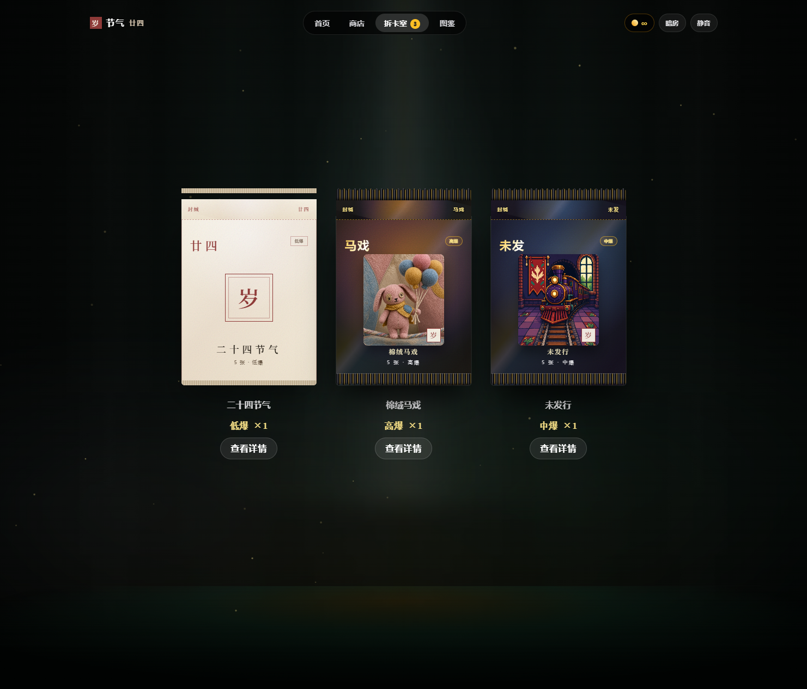
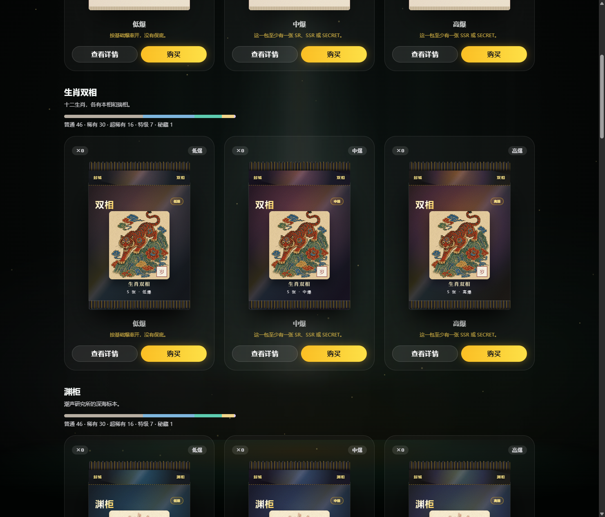
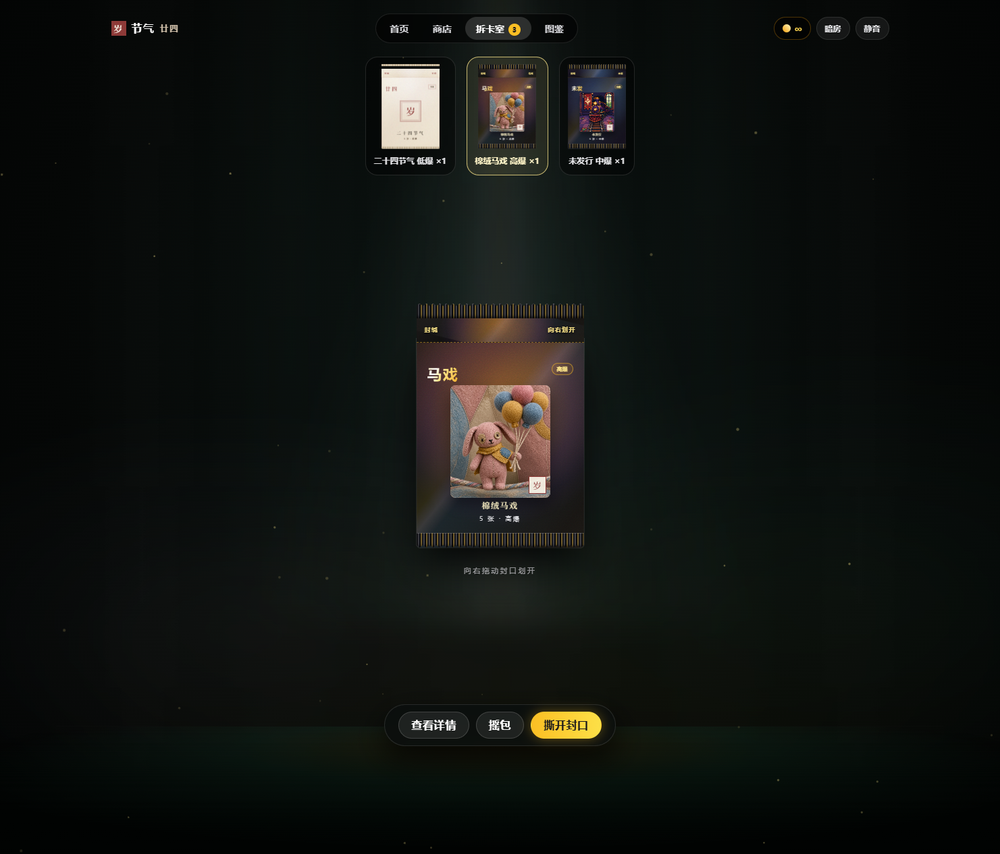
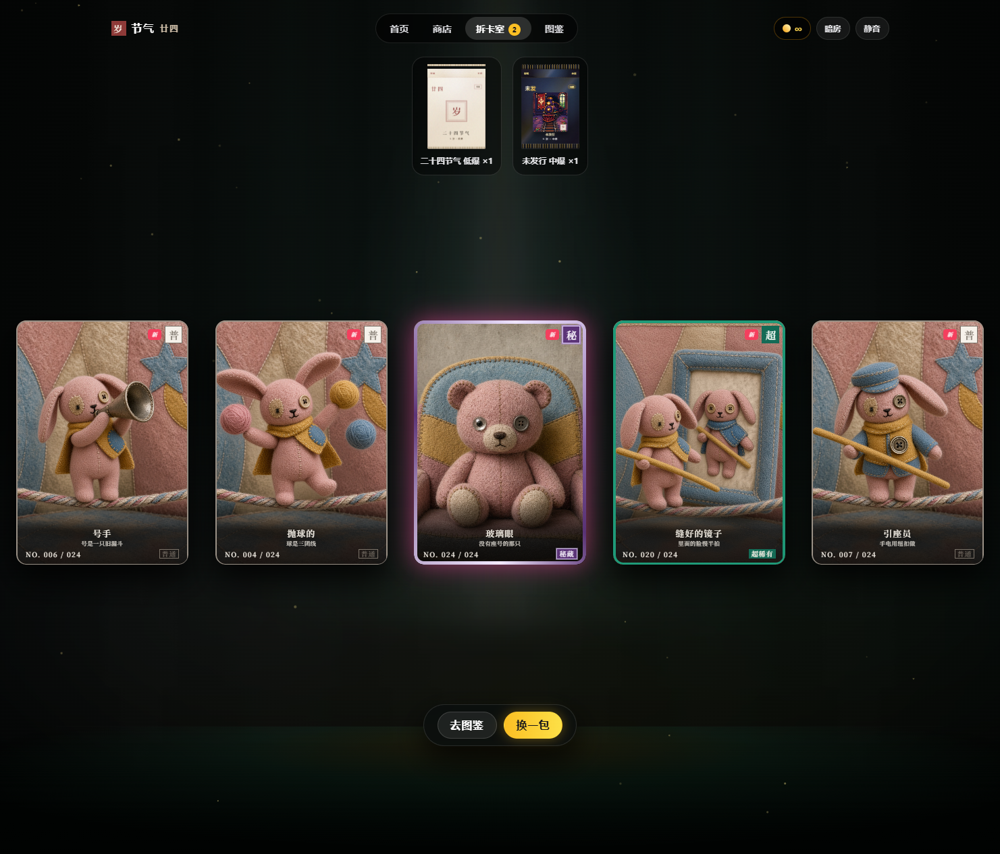
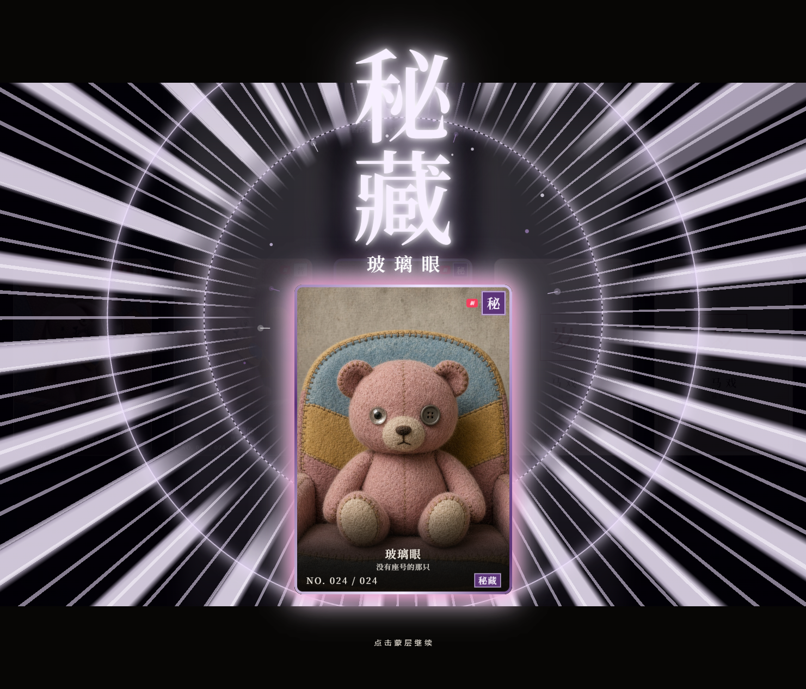
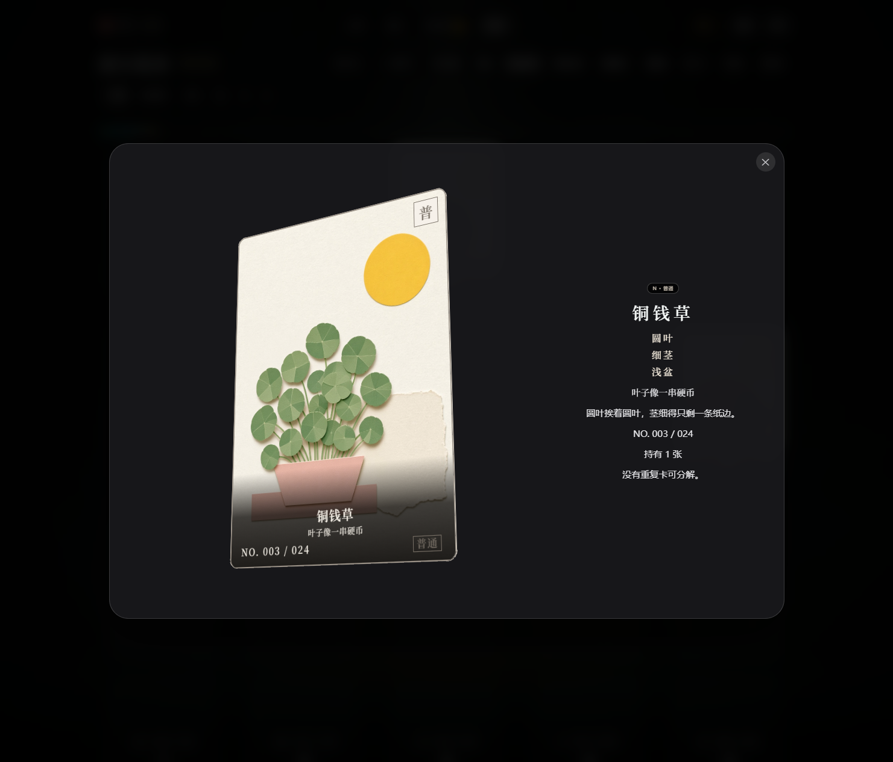

# 节气 · 二十四

在浏览器里撕开卡包，把十套收藏收进图鉴。没有服务器，也没有账号。进度写在本机 `localStorage`。

每套 24 张，每包开出 5 张，可以重复。二十四节气是一页册页，其余九套是整张画心。音效用 Web Audio 现合成。



## 十套卡包

| 卡包 | 这一套 |
| --- | --- |
| 二十四节气 | 工笔册页。画心在中间，节气名、三候和题款印在纸上 |
| 生肖双相 | 十二生肖，各有本相和瑞相。封面是下山的瑞相虎 |
| 渊柜 | 潮声研究所的深海标本。封面是停在海葵里的小丑鱼 |
| 窗台花房 | 窗台上的二十四个品种，纸片拼成。封面是绣球 |
| 棉绒马戏 | 旧衣服缝成的马戏团。封面是卖气球的兔子 |
| 末班电车 | 零点那一班车厢里的人。封面是黄雨衣 |
| 鞘翅匣 | 二十四格标本匣。封面是瓢虫 |
| 第二口 | 只做第二道菜的小馆。封面是一排煎饺 |
| 未发行 | 一枚没上市的卡带，里面二十四间房。封面是停在走廊里的火车 |
| 发条匣 | 钟表匠留下的二十四只盒子。封面是盒心里的一棵树 |



二十四节气是纸封，中间一枚「岁」印。其余九套是箔封，窗口里放这一套的封面，右下角仍盖「岁」印。低爆、中爆、高爆共用封面，封口上的档位不同。箔封的底色跟这一套的强调色走。

## 怎么玩

顶栏四个页面，旁边是灯光（暗房 / 展厅）和声效。拆卡室在有库存时显示待拆数量。

| 页面 | 做什么 |
| --- | --- |
| 首页 | 看第一套的高爆卡包。有库存就去拆卡室，没有就去商店。可以打开这一包的详情 |
| 商店 | 十套分栏。每一栏有低爆、中爆、高爆，并写出基础权重 |
| 拆卡室 | 选一只库存里的包。摇包看封边光，向右撕开，再翻五张 |
| 图鉴 | 按卡包、再按品级筛选。已收集的可以放大看，重复的可以分解 |

新游戏赠送一包二十四节气低爆。顶栏金币固定显示为无限。购买只增加库存，不扣金币。分解重复卡仍按品级把金币记进存档，界面上不显示具体数字。



拆卡室先选库存里的某一档。封着的时候可以摇包：封边按这一包已经抽定的最高品级发光。向右拖封口，没拖够松手会弹回去；也可以点「撕开封口」一次撕完。



撕开后扣掉这一包库存，五张写入图鉴。同一张在本包里只有第一次获得算新卡。玩家逐张翻开，或从左到右全部翻开。



超稀有、特级、秘藏会单独停一下，光和声音走完再继续。系统开启「减少动态效果」时，翻面几乎立刻完成，碎光和震屏不做，品级字还在。



图鉴里未收集的卡只留编号和品级。已收集的可以进入检视：拖动旋转，滚轮缩放。持有多于一张时可以分解一张。图鉴页可以清空存档。



## 抽取

十套共用同一组权重，合计 100。先抽品级，再在这一套该品级的卡里抽一张。

| 品级 | 名称 | 权重 |
| --- | --- | --- |
| `N` | 普通 | 46 |
| `R` | 稀有 | 30 |
| `SR` | 超稀有 | 16 |
| `SSR` | 特级 | 7 |
| `SECRET` | 秘藏 | 1 |

购买档：

- **低爆**：按权重抽，没有保底
- **中爆**：这一包至少一张超稀有、特级或秘藏
- **高爆**：这一包至少一张特级或秘藏

自然抽出的结果不够保底时，把其中最低的一张换成保底档。某一档要求的品级在这一套里不存在时，商店不会上架这一档。

二十四节气的分布：普通是雨水、小满、小暑、处暑、白露、小雪、小寒；稀有是惊蛰、清明、谷雨、芒种、大暑、寒露、霜降、大雪、大寒；超稀有是四立；特级是春分、夏至、秋分；秘藏是冬至。另外九套的品级写在每张卡上，见 `src/data/plates.ts`。

五档各用一种矿物色：松烟灰、花青、石绿、泥金、青莲。改色、撕开演出和翻开声音要五档一起看，见 [docs/开发规范.md](docs/开发规范.md)。

分解所得：普通 20、稀有 60、超稀有 160、特级 420、秘藏 1000。

## 存档

键名 `simplemkt.save.v1`。保存金币、各档库存、单卡持有数、累计开包次数、静音和灯光。当前页面和拆到一半的卡包不保存。缺字段或类型不对时，回到新玩家：200 金币、一包低爆、空图鉴。

旧存档里的 `standard` / `holo` / `vault` 会并入二十四节气的低爆、中爆、高爆。

## 本地运行

需要 Node.js `^20.19.0` 或 `>=22.12.0`。

```bash
npm install
npm run dev
```

生产构建：

```bash
npm run build
npm run preview
```

标题用 [Noto Serif SC](https://fonts.google.com/noto/specimen/Noto+Serif+SC)（思源宋体，SIL Open Font License），从 Google Fonts 加载。没有外网时页面仍能打开，字体会落到系统字体。

浏览器需要支持 CSS 3D、Web Audio、`crypto.randomUUID` 和 `localStorage`。桌面用指针，手机可以拖封口。

## 目录

```
src/
  types/game.ts          页面、品级、卡牌、卡包、存档
  data/solarTerms.ts     二十四节气
  data/plates.ts         九套画心卡
  data/catalog.ts        十套卡包、购买档、权重、封面
  data/pull.ts           抽卡与保底
  store/useGameStore.ts  库存、图鉴、存档
  audio/soundEngine.ts   程序化音效
  assets/solar/          节气画心
  assets/plates/         九套画心，一套一个目录
  components/            卡包、册页、画心、演出
  pages/                 首页、商店、拆卡室、图鉴
docs/prd.md              产品说明
docs/开发规范.md         改品级色、动效、音效时先看
docs/images/             本页用的界面截图
```

## 再加一套

1. 在 `src/data/plates.ts` 里用 `plate()` 加 24 张，`seriesId` 用新 id。图片放到 `src/assets/plates/{id}/01.jpg` 到 `24.jpg`，竖幅 864×1152。
2. 在 `src/data/catalog.ts` 的 `PACK_SERIES` 登记这个卡包。`accent` 是箔封的强调色，`cover` 填一张画心的路径，例如 `zodiac/15`。
3. 购买档沿用 `RATE_TIERS`。保底品级在该池里做不到时，这一档不会出现在商店。

节气册页走 `face` 不是 `plate` 的那条，画心放在 `src/assets/solar/`。新风格加在 `CardVisual` 上，用参数区分，不另做一套卡。品级色不要只改一个文件，见开发规范。

## 技术

React 19、TypeScript、Vite 7、Tailwind CSS 4。页面切换放在本地状态里，没有路由库。`package.json` 里 `"private": true` 只是避免被误发到 npm，仓库本身可以公开。

## 许可

[MIT](LICENSE)。物候短句取自传统七十二候。卡面图在本仓库的 `src/assets` 里。
